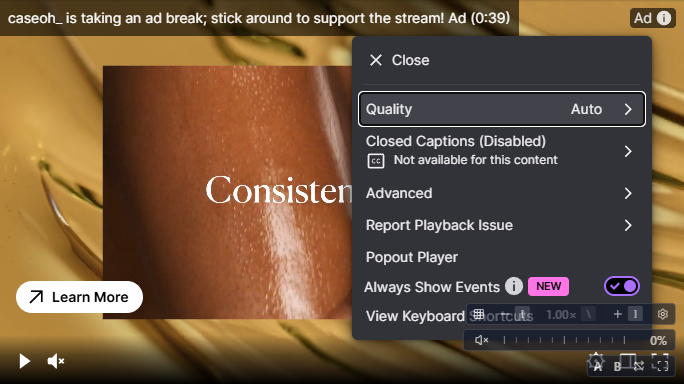
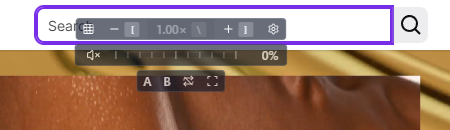

# Compatibility reconnaissance

Date: 2026-10-11 (America/Los_Angeles). Branch: `compatibility-recon`.
Production runtime remains the `91d027e` implementation; no runtime,
permissions, mounting, or site-policy code changed during this pass.

**Activation is unblocked in interactive Chrome. Phase 2 remains partial.**
The actual toolbar workflow succeeded on YouTube and Twitch. Twitch's
checklist produced reproducible stacking failures and an intermittent media
ownership finding. YouTube playback still failed on two public watch URLs;
its player checklist and in-page navigation remain pending. Max was skipped
because no authenticated, entitled session was available in the diagnostic
browser.

## Activation prerequisite

`pnpm dev --level warn` served the unchanged development extension. Installed
Google Chrome **154.0.8037.98** ran with a fresh anonymous profile. The extension
was loaded through Chrome's **Load unpacked** UI. Each site was opened
separately; OSVSC was opened from the actual Extensions toolbar menu, rather
than opening `popup.html` as a tab. The popup hostname and active tab URL were
checked before enabling the site, and the native confirmation was accepted.

Temporary diagnostics wrapped the popup's native permission and message APIs.
They called the originals synchronously, returned the original promises, and
captured their results without adding an `await` before the permission request.
Both requests had `navigator.userActivation.isActive === true`. The diagnostic
profile, browser, and development server were closed afterward. No account
credentials, cookies, or `storageState` were exported.

| Interactive Chrome result           | YouTube                               | Twitch                                |
| ----------------------------------- | ------------------------------------- | ------------------------------------- |
| Popup targets intended tab          | `www.youtube.com`, matching watch URL | `www.twitch.tv`, matching channel URL |
| Requested origin                    | `https://www.youtube.com:443/*`       | `https://www.twitch.tv:443/*`         |
| Native confirmation                 | Accepted                              | Accepted                              |
| `permissions.request()`             | Resolved `true`                       | Resolved `true`                       |
| Exact-port `permissions.contains()` | `true`                                | `true`                                |
| No-port `permissions.contains()`    | `false`                               | `false`                               |
| `ENABLE_SITE` response              | `{ "ok": true, "targetSpeed": 1 }`    | `{ "ok": true, "targetSpeed": 1 }`    |
| Popup enabled / OSVSC hosts         | Enabled / one host                    | Enabled / one host                    |

YouTube's `ENABLE_SITE` response was captured on an activation repeat after
correcting the diagnostic message shape. The first activation independently
resolved the permission request to true and created a host.

After YouTube activation, `permissions.getAll().origins` contained
`http://localhost/*` and `https://www.youtube.com:443/*`. After Twitch activation
it contained those plus `https://www.twitch.tv:443/*`. Named permissions were
`activeTab`, `storage`, `tabs`, and `scripting`; the additional `tabs` permission
is supplied by the existing WXT development build. No manifest permission was
added for this reconnaissance.

### Correction to the original probe

The earlier probe used the broader no-port patterns and did not capture the
request result, `getAll()`, or `ENABLE_SITE`. Its conclusion that host permission
remained ungranted was not established. Chrome documents an omitted port as a
wildcard; the narrower exact-port grant does not satisfy that broader query.
The interactive results above demonstrate this distinction directly.
See [Chrome match patterns](https://developer.chrome.com/docs/extensions/develop/concepts/match-patterns)
and the [Permissions API](https://developer.chrome.com/docs/extensions/reference/api/permissions).

The earlier disabled popup and zero hosts remain valid observations of
incomplete activation. Its initial sandbox navigations also failed with
`net::ERR_NETWORK_CHANGED`; retrying outside the sandbox loaded the public
pages. Those observations do not establish a player compatibility defect.

### Exploratory browser comparison

The earlier configuration was repeated with Chromium **153.0.8010.12**,
headless, using the same development extension and a popup opened as a tab.
Both exact-port requests were captured with an active user gesture, but
remained **pending**, not resolved false or rejected. Twitch was still pending
after a 30-second bounded check; YouTube was pending when captured. In both
cases, `getAll().origins` contained only the development localhost grant,
exact-port and no-port queries returned false, no `ENABLE_SITE` message had
been sent, and no overlay appeared. The contexts were then closed.

This is a testing-environment limitation for the attempted headless workflow:
interactive confirmation completed the normal workflow. Headless mode, popup
surface, and browser version differ between these sessions; this pass does
not isolate which difference prevents confirmation. There is no reproduced
ordinary-toolbar permission failure to justify changing production code.

## YouTube: activation succeeds, playback remains blocked

Visited public watch URLs:

- <https://www.youtube.com/watch?v=aqz-KE-bpKQ> — Big Buck Bunny 60fps 4K.
- <https://www.youtube.com/watch?v=YE7VzlLtp-4> — Big Buck Bunny.

The first player displayed “Something went wrong. Refresh or try again later.”
with `readyState: 0`, `currentTime: 0`, and a paused video before activation.
The second URL briefly reached `readyState: 4` while paused, but did not produce
advancing playback after attempts with its native play control. Its final
state was the same player error, `readyState: 0`, `currentTime: 0`, paused,
with **one OSVSC host**. Initial metadata readiness is not a playback pass.

The playback blocker is independent of the demonstrated permission grant.
The intended playing-video, controls, geometry, fullscreen, overlap, and SPA
navigation checks remain pending. No YouTube policy need is inferred from
this failed playback session. An earlier Twitch access candidate,
<https://www.twitch.tv/monstercat>, was offline and was not selected.

## Twitch: checklist with findings

Fixture: <https://www.twitch.tv/caseoh_>, public live channel, with an ad break
encountered during the session. Playback reached `readyState: 4`,
`paused: false`, and advancing current time. Normal views used a 1264 × 805
content viewport. Existing per-site options enabled the volume and extras
rows and disabled auto-hide; opacity stayed at 70% and scale at 100%.
Top center and bottom right positions were selected through Settings.
These settings existed already and changed only the disposable profile.

The stream was paused and speed control retaken for the repeatable UI probes
after the live ownership issue below. Those checks do not establish stable
speed ownership during live playback. Playback was resumed afterward.

| Checklist item                    | Observation                                                                                                                                                                                                  |
| --------------------------------- | ------------------------------------------------------------------------------------------------------------------------------------------------------------------------------------------------------------ |
| Intended playing video            | One video and one host; overlay was visible on resumed playback. Intermittent live surrender also hid it, as recorded below.                                                                                 |
| Speed and volume                  | On the paused video, toolbar and overlay Faster changed rate from 1 to 1.25; Reset restored 1. The volume slider changed volume from 0 to 0.5 and unmuted; mute restored silence.                            |
| Same-size layout movement         | Dismissing the cookie notice with Enter moved the video up 172px without resizing, and the host followed.                                                                                                    |
| Wrapper fullscreen                | Twitch's native control entered wrapper fullscreen; OSVSC was inside that wrapper and visible. Native exit restored the root portal and correct anchor after layout settled.                                 |
| Native video fullscreen           | OSVSC's fullscreen control entered video fullscreen; its button became pressed and its host hid as intended. `document.exitFullscreen()` restored the portal, visible host, and anchor after layout settled. |
| Player/page chrome covering OSVSC | Checked in the menu and header overlaps below; no such coverage reproduced there. Native video fullscreen hid the extension overlay intentionally.                                                           |
| OSVSC covering player/page chrome | Reproduced in both the player menu and sticky header, with independent visual and pointer evidence.                                                                                                          |
| After scroll                      | Menu overlap remained observable after scrolling; the default top-center position obstructed header search after a 40px scroll.                                                                              |

The cookie-notice measurement was video `(240,222,684,384.75)` to
`(240,50,684,384.75)`, and top-center host `(582,230)` to `(582,58)`.
There were zero pointer events and zero window resize events, but three scroll
signals. This proves the observed geometry followed the move; it does not
isolate the ancestor attribute watcher from scroll invalidation. No matching
watched-ancestor regression was demonstrated, so the local lifecycle control
was not rerun.

### Finding T1 — stacking: player settings menu

Trigger: select bottom right, reveal the native player settings menu, and
inspect its lower rows. OSVSC paints over “View Keyboard Shortcuts” and
intercepts the row's pointer region. The menu row spanned
`x=599..883, y=350.41..382`; OSVSC's Faster button was at `(866.5,363.75)`,
inside that row. `document.elementFromPoint()` returned `OSVSC-OVERLAY`;
shadow hit testing identified **Faster**. Clicking changed the video's rate
from 1 to 1.25 instead of opening keyboard shortcuts. The overlap was also
observed after scrolling and reopening the menu.

- Intended visual winner: the open native settings menu.
- Actual visual winner: OSVSC controls, as the screenshot shows.
- Intended pointer receiver: the native menu row.
- Actual pointer receiver: OSVSC's Faster button, confirmed by the rate change.

### Finding T2 — stacking: sticky header search

Trigger: use top center, close the player menu, and scroll the root scroller
40px. The video moved to `(239,10,684,384.75)`, leaving its upper edge behind
the header. OSVSC's rectangle was approximately `(474.41,18,213.17,74)`.
The header search field spanned `x=436..792, y=7..43`.
At `(637.60,29)`, inside search, hit testing again selected OSVSC's **Faster**.
Clicking changed speed to 1.25 instead of focusing search; the active element
was body rather than the search input.

- Intended visual winner: the sticky page header and its search field.
- Actual visual winner: OSVSC, over the search field.
- Intended pointer receiver: the search input.
- Actual pointer receiver: OSVSC's Faster button.

Both stacking findings are reproducible, product-relevant obstructions.
Stacking was a non-goal of the generic geometry slice; that explains the
boundary but does not dismiss these failures. They warrant a future
compatibility fix. This pass does not choose its declarative field or implement
yielding, restacking, mounting changes, or a site handler.

### Finding T3 — media: intermittent live control surrender

On two observations during live playback, the controller surrendered and hid
OSVSC even with auto-hide disabled. One captured state was target speed 1,
actual rate `1.0299999713897705`, `retryCount: 4`, `surrendered: true`,
`readyState: 4`, and `paused: false`. The overlay visibility was hidden.
Pausing and changing the target allowed the UI probes to continue. The final
sample returned to rate 1, no retries, a non-surrendered controller, and a
visible overlay during playback.

Live latency correction is a possible explanation, not an established cause.
The writer and recovery trigger were not traced. Record this as an intermittent
media finding requiring follow-up, rather than inferring a permanent failure
or adding another policy field. The catalog policy-need flag below is justified
independently by T1 and T2.

## Max and catalog bookkeeping

Max was not opened: this diagnostic profile had no existing authenticated,
entitled session. No login or credential capture was attempted. All Max checks
remain unchanged and false.

YouTube and Twitch retain `fixtureIdentified: true`. Only Twitch now has
`genericEvaluated: true` and `builtinPolicyRequired: true`, based on the manual
checklist and stacking evidence. Its active policy remains `generic`: the
required fix is pending. YouTube retains false evaluation and policy-need flags.
`externalSmoke` stays false for both; these exploratory manual checks are not
an automated external smoke suite. Every other catalog row is unchanged.

## Next action

Review T1 and T2 before selecting any compatibility field, and investigate T3
without treating a known generic behavior as automatic dismissal. Resume the
YouTube checklist and one SPA navigation only when its media actually plays.
Max remains skipped without an entitled session. Phase 2 is not complete while
the YouTube checklist is blocked. Presentation-contract and Custom CSS work
remain deferred. No public-site test project, permission fixture grant,
stored authenticated session, or production runtime change was added.
